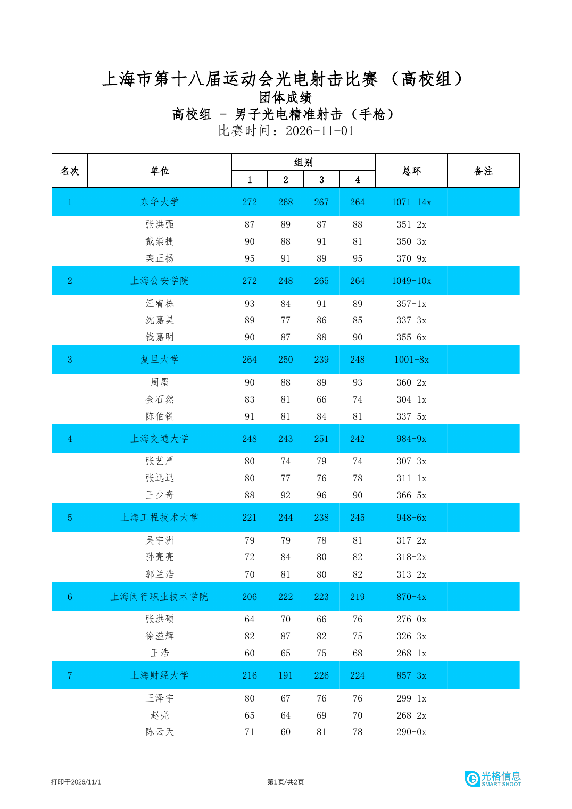
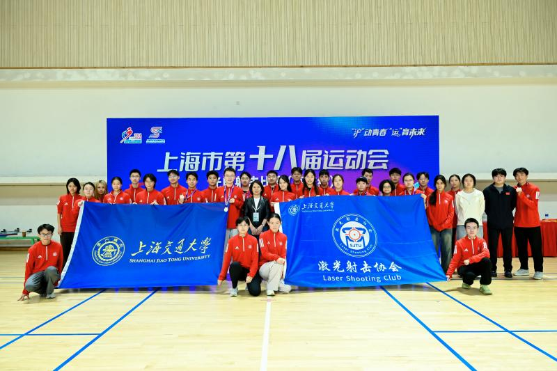
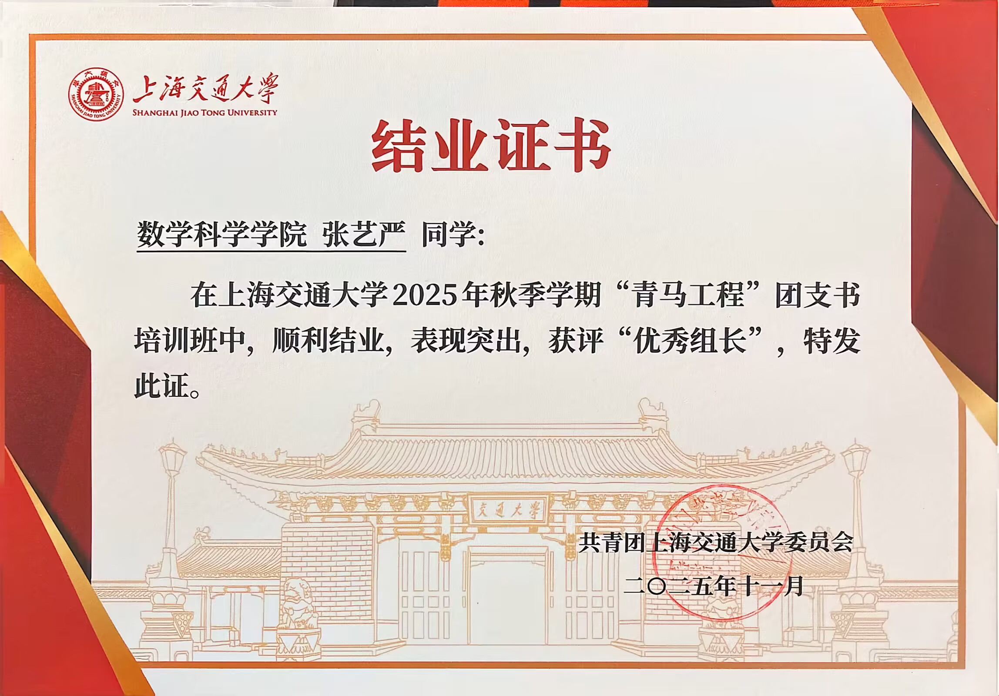
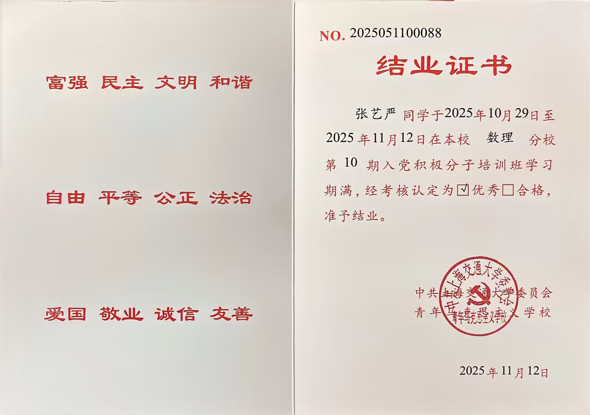
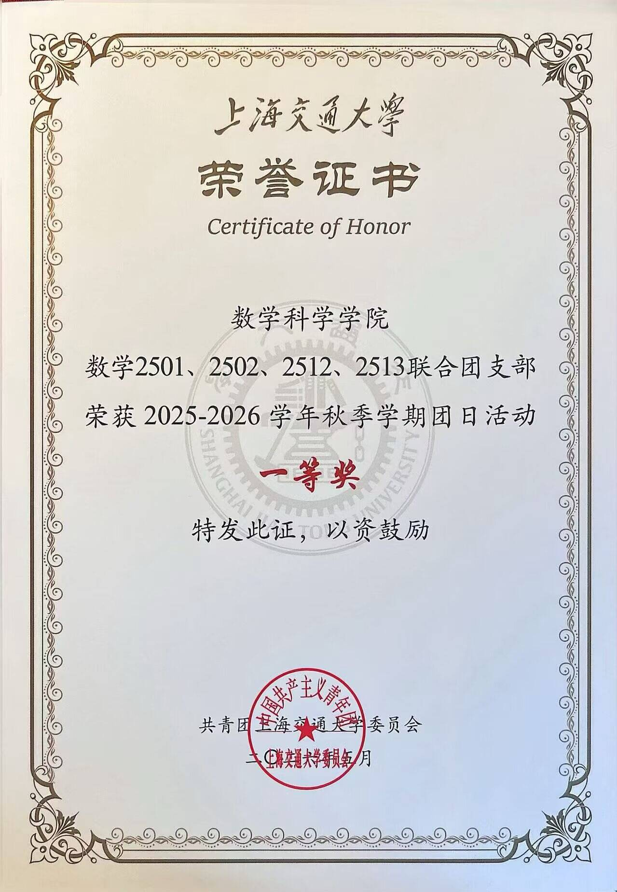
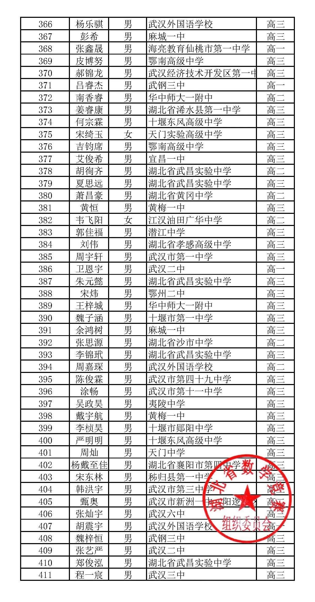
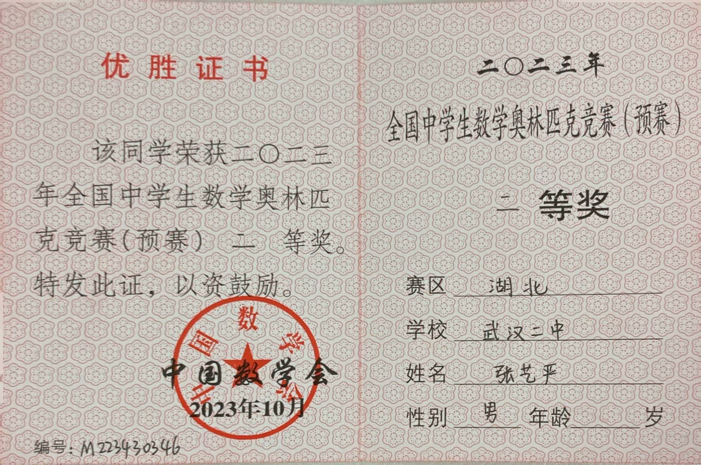
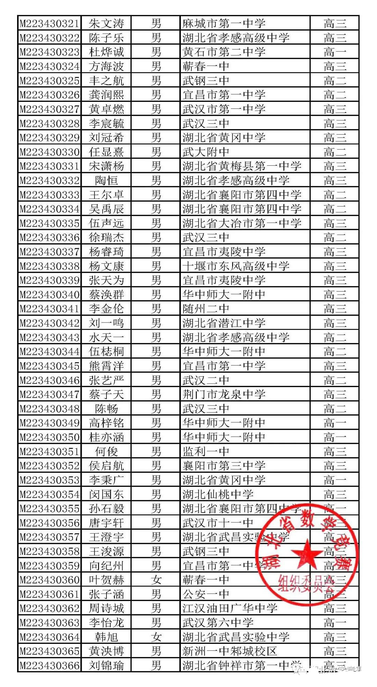

# 张艺严

**数学与应用数学 · 人工智能**

[GitHub](https://github.com/Wenxin666-code)

## 个人简介

上海交通大学本科二年级在读，攻读数学与应用数学、人工智能双学位。

## 联系方式

展开查看联系方式

<blockquote>

| 邮箱 | 地址 |
| :--- | :--- |
| 上海交通大学 | [zhangyiyan@sjtu.edu.cn](mailto:zhangyiyan@sjtu.edu.cn) |
| QQ | [2393089894@qq.com](mailto:2393089894@qq.com) |
| Gmail | [yiyanz@gmail.com](mailto:yiyanz@gmail.com) |
| Outlook | [yiyanz459@outlook.com](mailto:yiyanz459@outlook.com) |

</blockquote>

## 教育背景

展开查看教育背景

<blockquote>

| 时间 | 学校 | 专业 / 阶段 |
| :--- | :--- | :--- |
| 2025.09 — 至今 | 上海交通大学 | 数学与应用数学、人工智能双学位；本科二年级在读 |
| 2022 — 2025 | 武汉二中 | 高中 |

**高考成绩**：678 分，湖北省第 152 名。

<!-- 高中就读年份根据所提供的高中学生工作与大学入学时间整理，具体入学和毕业月份待补充。 -->

<strong>本科已修读课程</strong>

<blockquote>

- 高等代数（荣誉）I
- 数学分析（荣誉）I
- 程序设计思想与方法（C++）
- 高等代数（荣誉）II
- 数学分析（荣誉）II
- 大学物理（荣誉）（1）
- 离散数学
- 数据结构
- 人工智能基础（A）
- 基础物理实验（荣誉）（1）
- 英汉口译
- 拓扑学基础
- 编程综合实践

</blockquote>

</blockquote>

## 项目导航

展开查看分类项目导航

<blockquote>

### 科研与科学计算

| 项目 | 简介 | 入口 |
| :--- | :--- | :--- |
| 2026年全国大学生数学建模竞赛A题 | 药材热湿传递与收缩干燥建模，包含论文、程序、数据及验证材料 | [项目仓库](https://github.com/Wenxin666-code/cumcm-2026-a) |

### 游戏开发

| 项目 | 简介 | 入口 |
| :--- | :--- | :--- |
| AlphaMeow（阿法喵呜） | 浏览器五子棋 AI，结合策略网络与棋形搜索，支持执黑或执白 | [项目仓库](https://github.com/Wenxin666-code/AlphaMeow) · [在线对弈](https://wenxin666-code.github.io/AlphaMeow/) |
| 断线前沿 · Greyhaven RTS | Godot等距视角单人即时战略游戏 | [项目仓库](https://github.com/Wenxin666-code/greyhaven-rts) · [游戏下载](https://github.com/Wenxin666-code/greyhaven-rts/releases) |
| 二中杀 · 桌面单机版 | Pygame桌面单机卡牌游戏，含DIY技能与AI对战 | [项目仓库](https://github.com/Wenxin666-code/erzhongsha-desktop) · [游戏下载](https://github.com/Wenxin666-code/erzhongsha-desktop/releases/latest/download/Erzhongsha-windows-x64.zip) |
| Game Jam 玩法与角色原型 | Godot程序化玩法、角色与场景原型（Fork仓库） | [项目仓库](https://github.com/Wenxin666-code/gamejam_2612_turn) |

</blockquote>

## 科研工作

展开查看科研工作

<blockquote>

- **标准（2,2）猜想的轻权冲突匹配与整体重染｜进行中**  
  研究图的边着色与边赋权，分析冲突边的结构与整体重染条件，并用 Lean 对部分结果进行形式化验证。  
  [论文仓库](https://github.com/Wenxin666-code/standard-2-2-conjecture-conflict-matchings)

- **基于物理信息神经算子的超材料力学性能预测｜进行中**  
  参与科研数据处理、神经网络模型搭建与实验评估，探索人工智能在材料力学性能预测中的应用。

- **暑期科研见习（PRP）· AI材料计算助研岗｜已结题**  
  2026.07 — 2026.08｜项目编号：T260SRIP01002｜负责人：黎阳

</blockquote>

## 实习与工作经历

展开查看实习与工作经历

<blockquote>

<strong>深圳聚塔时代材料科技有限公司</strong> ｜ 2026.07 — 至今

<blockquote>

**部门**：上海研究发展中心

**岗位**：工程师（实习）

**参与项目**：AI for Materials 实习项目

</blockquote>

</blockquote>

## 学生工作

展开查看任职与工作详情

<blockquote>

<strong>上海交通大学 · 2513班团支部书记</strong> ｜ 2025.10 — 至今

<blockquote>

- **2026.11**｜组织“星火晤面·与时代同行者对话”四班团支部联合团日活动。
- **2026.09**｜参与本科生综合测评审核工作。
- **2026.05**｜组织“戏文有散场 家国无落幕”四班团支部联合团日活动。
- **2026.04**｜组织开展班级五四评优工作。
- **2026.02**｜组织开展班级组织生活会及团员教育评议。
- **2025.12**｜参与组织钱学森图书馆参观活动。
- **2025.11**｜组织“百年薪火传 青春跟党走”四班团支部联合团日活动，活动获得一等奖。  
  [查看活动报道](https://mp.weixin.qq.com/s/ZiPnFbI9VCLlCcJMuUCZDw) · [查看获奖公示](https://mp.weixin.qq.com/s/53s7sM7iX-NFoUYpZzaZIw)
- **2025.11**｜担任“青马工程”团支书培训班大组长，获评“优秀组长”。
- **2025.10**｜担任2513班团支部书记，协助老师开展团组织关系转入工作。

</blockquote>

<strong>上海交通大学数学科学学院学生会 · 文体部干事</strong> ｜ 2026.03 — 至今

<blockquote>

- **2026.09**｜参与“秋是__”游园会的学生工作。
- **2026.04**｜参与“交大人节”的学生工作。
- **2026.03**｜加入数学科学学院学生会文体部，参与“春日雅集”的学生工作。

</blockquote>

<strong>上海交通大学校团委组织部 · 团务中心干事</strong> ｜ 2026.11 — 至今

<blockquote>

- **2026.11**｜参与2026年三好学生、优秀学生干部审核工作。
- **2026.11**｜加入上海交通大学校团委组织部团务中心，担任干事。

</blockquote>

<strong>上海交通大学第三十八次学生代表大会 · 第4代表团学生代表</strong> ｜ 2026.11 — 至今

<blockquote>

- **2026.11**｜成为第三十八次学生代表大会第4代表团学生代表，参与学生代表提案工作。

</blockquote>

<strong>武汉二中 · 学生会与班级工作</strong> ｜ 2022.09 — 2025.06

<blockquote>

**任职与组织建设**

- **2023.06**：担任学生会副主席、秘书处秘书长、文体部部长兼企划小组组长；创建学生会外联部，任首任部长。
- **2022.12**：创立学生会外联小组。
- **2022.09**：通过学生会面试；担任班级团支部书记、心理委员。

**代表工作**

2022—2025年，累计组织、参与组织及指导 **22场校园与校际活动**，其中组织 **8场**、参与组织 **9场**、指导 **5场**。

#### 校园文体

- **2025.01**｜指导“青春流韵·梦想飞扬”人文艺术节暨2025年元旦文艺汇演相关工作。
- **2024.10**｜指导“斑斓社团节”社团路演活动相关工作。
- **2024.10**｜指导“文以载道 义正辞约”校园主持人大赛相关工作。
- **2024.06**｜组织武汉二中“致远杯”三人篮球赛。
- **2024.06**｜参与组织“辩以明志 论而博学”辩论赛。  
  [查看活动报道](https://mp.weixin.qq.com/s/6bTkqffnuKmLjp3cRjkpMg)
- **2023.12**｜组织“青春飞扬 梦想启航”人文艺术节暨元旦文艺汇演。
- **2023.12**｜组织校拔河比赛。
- **2023.11**｜参与组织第二届“舒展筋骨 律动青春”校广播操大赛。
- **2023.10**｜组织“雏凤新声，声声动人”校园主持人大赛。
- **2023.10**｜组织“斑斓社团节 共筑青春梦”社团路演招新活动。
- **2023.09**｜组织“斑斓社团节”社团路演活动。
- **2023.03**｜参与组织“斑斓社团节 启航新时代”社团路演活动。
- **2023.03**｜参与组织首届“舒展筋骨 律动青春”校广播操大赛。
- **2022.10**｜参与组织“启迪杯”校园主持人大赛。

#### 校际联动

- **2024.03**｜组织“花开并蒂 风采各异”四校外联活动。
- **2023.03**｜参与组织“以邻为镜相拂照 众木成林共争春”五校外联活动。
- **2022.11**｜参与组织第二届“落笔拾秋”四校外联活动。

#### 成长教育与校园主题活动

- **2025.05**｜指导“淬琥珀年华 溯天阙星光”成人礼相关工作。
- **2025.03**｜指导校园开放日相关工作。
- **2024.05**｜组织“山止川行·青春永不散场”成人礼。
- **2023.05**｜参与组织“感恩成长 放飞梦想”成人礼。
- **2023.05**｜参与组织武汉二中纪念五四运动104周年暨2022—2023学年度表彰大会。

#### 校园宣传

- **2025.05**｜作为学生代表出席高考心理赋能讲座，并撰写通讯稿。
- **2024.07**｜出席第29—30届学生会换届仪式，作为第29届学生会成员代表发言。  
  [查看活动报道](https://mp.weixin.qq.com/s/JeSlFYGIl9ATyMhJeVQGLQ)
- **2023.09**｜作为学生代表，为校感恩节庆典拍摄感恩视频。
- **2023.06**｜参与创建武汉二中B站官方账号。

#### 团务工作

- **2025.08**｜协助校团委老师开展团组织关系转出工作。
- **2023.11**｜作为团支书参与共青团员入团仪式。

<!-- 活动总数依据本人逐条经历：8项组织、9项参与组织、5项指导；按不同日期分别计数。宣传、代表发言及仅参与的团务活动未计入活动组织总数。 -->

</blockquote>

<strong>其他</strong>

<blockquote>

- **2026.07｜社会实践小组长**：在“探微绿境寻幽萃·数智申城绘锦图”社会实践活动中担任小组长。
- **2025.09｜新生代表发言**：出席上海交通大学湖北校友会迎新送新会，作为新生代表发言。  
  [查看活动报道](https://mp.weixin.qq.com/s/GIW4Aqpt79ARkzs--71HcA)

</blockquote>

</blockquote>

## 获得荣誉

展开查看荣誉、证书与成绩记录

<blockquote>

| 时间 | 荣誉 / 奖项 | 相关活动 / 说明 |
| :--- | :--- | :--- |
| 2026.11 | 上海赛区本科组三等奖 | 2026年“高教社杯”全国大学生数学建模竞赛 |
| 2026.11 | 男子光电精准射击（手枪）团体第四名 | 上海市第十八届运动会（高校组） |
| 2026.04 | 校级优秀团员 | 五四评优 |
| 2025.11 | 优秀组长 | “青马工程”团支书培训班 |
| 2025.11 | 结业考核优秀 | 数理分校第10期入党积极分子培训班 |
| 2025.11 | 一等奖（集体荣誉） | 组织的“百年薪火传 青春跟党走”四班团支部联合团日活动获奖 |
| 2025.04 | 校级优秀团员 | 五四评优 |
| 2024.10 | 湖北赛区二等奖 | 全国高中数学联合竞赛 |
| 2023.10 | 湖北赛区二等奖 | 全国高中数学联合竞赛 |

<!-- 按已提供的信息记录荣誉、获奖时间与活动背景。 -->

### 证书与成绩记录

2026年全国大学生数学建模竞赛 · 上海赛区本科组三等奖公示

<blockquote>

公示名单第27张图片、本科组三等奖序号495：上海交通大学，张艺严。

[查看完整公示（中国大学生在线，2026.11.11）](https://dxs.moe.gov.cn/zx/a/hd_sxjm_smkx/261111/2060187.shtml) · [查看项目代码与论文](https://github.com/Wenxin666-code/cumcm-2026-a)

*以上依据获奖名单初稿公示记录，非获奖证书。*

</blockquote>

2026.11 上海市第十八届运动会 · 男子手枪团体第四名

<blockquote>

2026年11月1日，代表上海交通大学参加高校组男子光电精准射击（手枪）比赛，获得团体第四名，总成绩984环。

[查看学校官方报道及参赛名单](https://news.sjtu.edu.cn/zhxw/20261105/227287.html)

代表队合影（来源：上海交通大学新闻学术网，照片不标注个人位置）：

</blockquote>

2025.11 “青马工程”团支书培训班 · 优秀组长证书

<blockquote>

</blockquote>

2025.11 入党积极分子培训班 · 结业考核优秀证书

<blockquote>

</blockquote>

2025—2026学年秋季学期联合团日活动 · 一等奖证书（集体荣誉）

<blockquote>

获奖集体为数学2501、2502、2512、2513联合团支部。

</blockquote>

2024.10 全国高中数学联合竞赛 · 湖北赛区二等奖

<blockquote>

获奖名单序号409：张艺严，武汉二中，高三。

*名单来源：湖北省数学竞赛组织委员会，自主选拔在线转载*

</blockquote>

2023.10 全国高中数学联合竞赛 · 湖北赛区二等奖

<blockquote>

获奖名单编号M223430346：张艺严，武汉二中，高二；编号与证书一致。

*名单来源：湖北省数学竞赛组织委员会，自主选拔在线转载*

</blockquote>

</blockquote>

<!--
## 专业技能

- **专业方法与工具**：待补充，仅列出能够说明实际使用场景的内容。
- **编程与数据处理**：待补充，可结合项目说明掌握程度。
- **其他能力**：待补充，按实际情况填写语言、写作或组织协作能力。
-->

<!-- 专业技能栏目补充后，可移除其 HTML 注释以展示。 -->
